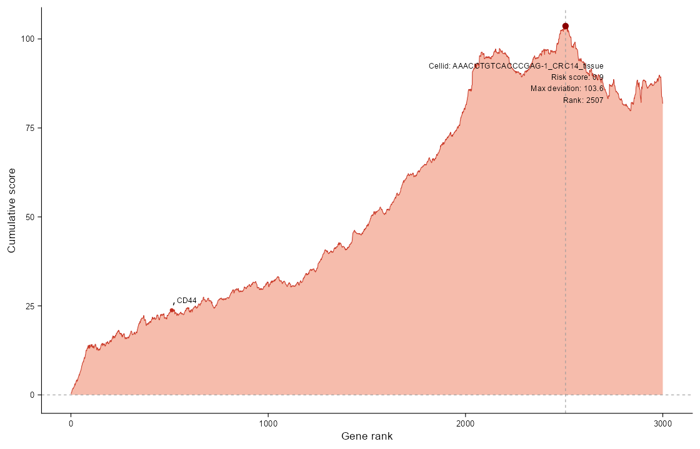

# SCARP

Single-Cell Chemoresistance Assessment via Rank-Based Projection

## Description

We developed a rank-based cumulative scoring algorithm, termed SCARP, to quantify chemotherapy resistance at single-cell resolution in colorectal cancer (CRC). Gene-specific log fold-change (logFC) values were derived from differential expression analysis between chemotherapy non-response (NR) and response (R) samples in a CRC chemotherapy-response dataset and were incorporated into SCARP as a reference chemoresistance signature. Under the NR-versus-R contrast, positive logFC values represent genes preferentially expressed in non-response samples, whereas negative logFC values represent genes preferentially expressed in response samples.

For each cell, genes were ranked according to their normalized expression levels, and the corresponding gene-specific logFC values were cumulatively summed along the ranked gene list. The cumulative deviation with the largest absolute magnitude was defined as the observed score (MaxScore). To account for expression-dependent background variation, TopN genes were randomly sampled without replacement from the top 50% of matched genes ranked by mean expression for 3,000 iterations. Sampled genes retained their mean-expression rank order. The resulting empirical distribution was used to estimate the background mean (Random_mean) and standard deviation (Random_sd).

The observed score was standardized against this background and further adjusted using a position weight (Pw), which emphasizes deviations arising from highly ranked genes, and a direction strength term (Ds), which captures the dominance of the non-response- or response-associated cumulative trajectory. The final single-cell chemoresistance score was calculated as (MaxScore - Random_mean) / Random_sd * Pw * Ds. Positive scores indicate a more positive signed deviation relative to the empirical background, associated with the non-response signature; negative scores indicate a more negative deviation relative to that background. Because the score is background-centered, its sign need not equal the sign of the unstandardized cumulative deviation. It is a transcriptional signature score, not a probability of clinical chemoresistance.

## Installation

```r
# install.packages("remotes")
remotes::install_github("XLXhmu/SCARP")
```

## Usage

### 1. Single-Cell Chemoresistance Assessment via Rank-Based Projection

Calculate a chemoresistance signature score for each cell using the bundled
NR-versus-R logFC reference.

```r
library(SCARP)

# Load the example data
data(object)

# Extract the RNA count matrix; counts preserve the within-cell expression ranks
mat <- SeuratObject::LayerData(object, assay = "RNA", layer = "counts")

# Compute single-cell chemoresistance scores
set.seed(123)
res <- Scarp(mat = mat, topN = 3000)
head(res)
```

A normalized gene-by-cell expression matrix can also be supplied as `mat`.
`topN` must not exceed half the number of genes shared with the reference.
The score compares each cell with an empirical background; it is not a clinical
probability of chemoresistance.

### 2. Plot the cumulative enrichment curve of one cell

Display the cumulative logFC trajectory of a selected cell, mark its maximum
absolute deviation, and annotate genes of interest.

```r
library(SCARP)

# Load the example data
data(object)
mat <- SeuratObject::LayerData(object, assay = "RNA", layer = "counts")

# Compute scores (reuse res from the first example if already available)
set.seed(123)
res <- Scarp(mat = mat, topN = 3000)

# Plot one cell
cell_id <- colnames(mat)[1]
p <- cumulativeCurve(
  mat = mat,
  cell_id = cell_id,
  risk_score = res[[cell_id]],
  topN = 3000,
  target_genes = c("CD44", "EPCAM", "PROM1", "ABCB1", "ABCG2", "ALDH1A1")
)
print(p)
```



The plotting function includes zero-expression genes and uses deterministic tie
ordering. Scoring excludes zero-expression genes and breaks ties randomly, so
the displayed curve can differ from the trajectory used for scoring.
Use `set.seed()` for reproducible scores.

## Example data

- `gene_Diff`: 19,157 named DESeq2 logFC values for chemotherapy Non-Response (NR)
  versus Response (R); positive values are associated with non-response.
- `object`: 33,538 genes and 10,419 cells from pretreatment tumor samples of two
  patients, supplied from the Zhang Zemin single-cell dataset.

## License

MIT; see [LICENSE.md](LICENSE.md).
